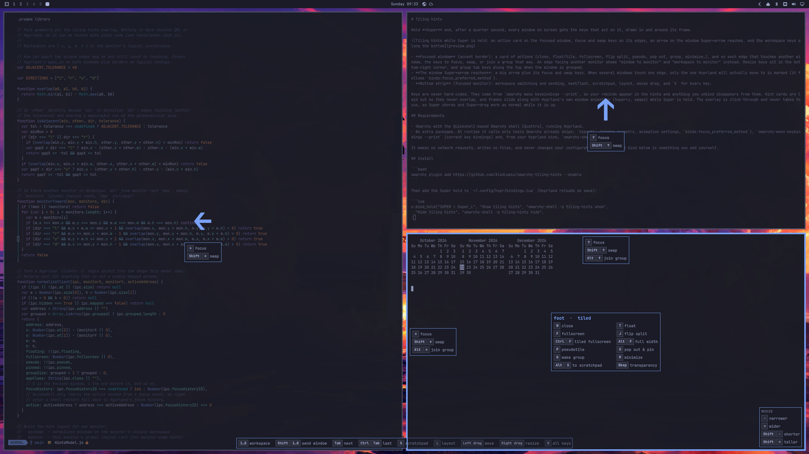

# Tiling hints

Hold **Super** and, after a quarter second, every window on screen gets the keys that act on it, drawn in and around its frame.



- **Focused window** (accent border): a card of actions (close, float/tile, fullscreen, flip split, pseudo, pop out, group, minimize…), and on each edge that touches another window, the keys to focus, swap, or join a group that way. An edge facing another monitor shows "window to monitor" and "workspace to monitor" instead. Resize keys sit in the bottom-right corner, and group tab keys along the top when the window is grouped.
- **The window Super+arrow reaches**: a big arrow plus its focus and swap keys. When several windows touch one edge, only the one Hyprland will actually move to is marked (it follows `binds:focus_preferred_method`).
- **Bottom strip** (focused monitor): workspace switching and sending, next/last, scratchpad, layout, mouse drag, and `K` for every key.

Keys are never hard-coded. They come from `omarchy menu keybindings --print`, so your rebinds appear in the hints and anything you unbind disappears from them. Hint cards are laid out so they never overlap, and frames slide along with Hyprland's own window animation (Super+J, swaps) while Super is held. The overlay is click-through and never takes focus, so Super chords and Super+drag work as normal while it is up.

## Requirements

- Omarchy with the Quickshell-based Omarchy shell (Quattro), running Hyprland.
- No extra packages. At runtime it calls only tools Omarchy already ships: `hyprctl` (window geometry, animation settings, `binds:focus_preferred_method`), `omarchy-menu-keybindings --print` (current key bindings) and, from your Hyprland bind, `omarchy-shell`.

It makes no network requests, writes no files, and never changes your configuration: the Hyprland bind below is something you add yourself.

## Install

```bash
omarchy plugin add https://github.com/AledLewis/omarchy-tiling-hints --enable
```

Then add the Super hold to `~/.config/hypr/bindings.lua` (Hyprland reloads on save):

```lua
o.bind_hold("SUPER + Super_L", "Show tiling hints", "omarchy-shell -q tiling-hints show",
  "Hide tiling hints", "omarchy-shell -q tiling-hints hide",
  { ignore_mods = true, non_consuming = true })
```

The bind is non-consuming and ignores other modifiers, so every existing Super shortcut keeps working.

Update later with `omarchy plugin update aledlewis.tiling-hints`, then `omarchy restart shell`.

## Remove

1. Delete the `o.bind_hold("SUPER + Super_L", ...)` lines from `~/.config/hypr/bindings.lua`.
2. Remove the plugin:

   ```bash
   omarchy plugin remove aledlewis.tiling-hints
   ```

## Tuning

At the top of `Service.qml`: `showDelay` (ms before the overlay appears, so quick chords don't flash it) and `maxHold` (safety auto-hide if a key release is ever missed).

## IPC

`omarchy-shell tiling-hints show | hide | toggle | state`

## Developing

Clone the repo anywhere and symlink it in place of the installed copy:

```bash
ln -sfn "$PWD" ~/.config/omarchy/plugins/aledlewis.tiling-hints
```

The shell loads service plugins once, so run `omarchy restart shell` after editing the QML.

Tests: `node tests/model.test.js` covers window adjacency, which window Super+arrow reaches, monitor edges, fullscreen, keybinding parsing, animation settings and card placement.

## License

[MIT](LICENSE)
